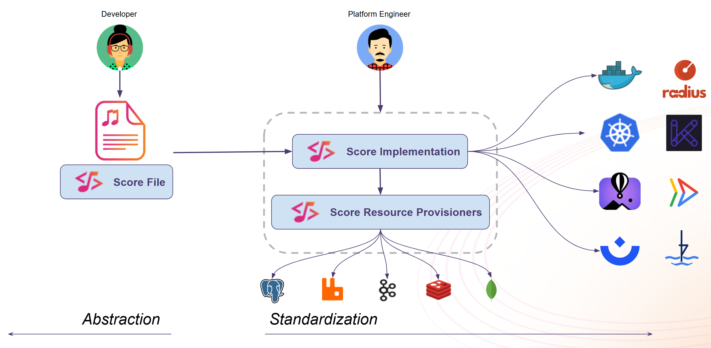

# What is Score?

Score is an open-source and a [CNCF Sandbox project](https://www.cncf.io/projects/score/).

Score aims to reduce developer toil and cognitive load by enabling the definition of a single file that works across multiple platforms in a vendor-neutral way, eliminating the need for tooling-specific syntax from platforms such as Docker or Kubernetes for example.

On one hand ("**Abstraction**"), the Score spec allows **Developers** to define how they want to deploy their Workloads. And on the other hand ("**Standardization**"), **Platform Engineers** define well supported golden paths by using Score implementations supported for their platform(s) with associated resource provisioners.

## Key concepts

Keep these terms in mind, you will use each of them during this lab:

| Concept | What it is | Who owns it |
|---|---|---|
| **Workload** | A service or application you want to run, made of one or more containers. | Developers |
| **Score file** (`score.yaml`) | The platform-agnostic YAML file describing a Workload and what it needs. | Developers |
| **Resource** | A dependency of the Workload (a database, a DNS name, a route, ...) requested by its `type`, without saying _how_ it is implemented. | Developers request it |
| **Score implementation** | A CLI that converts a Score file into platform-specific files: `score-compose` generates a `compose.yaml`, `score-k8s` generates Kubernetes manifests. | Platform Engineers |
| **Resource provisioner** | The definition of _how_ a resource type is actually created on a given platform, and which outputs (host, port, password, ...) it gives back to the Workload. | Platform Engineers |
| **Patch template** | A way to tweak any field of the generated files (security settings, labels, ...) for every Workload. | Platform Engineers |

The key idea: Developers describe **what** they need, Platform Engineers decide **how** it is provided.

## Resources

- [Score implementations](https://docs.score.dev/docs/score-implementation/)
