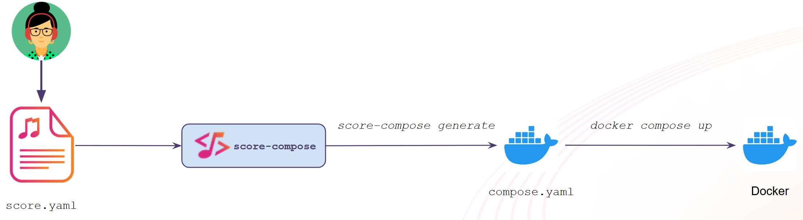

# Getting started with `score-compose`

But from this `score.yaml` file we haven't deployed anything just yet.

Let's now deploy this workload locally with Docker Compose!

We'll use the `score-compose` implementation for that.



Initialize your current `score-compose` workspace, run the following command in your terminal:
```bash
score-compose init
```

_Note: The `init` command created the `.score-compose` directory to store a local state, read more about its purpose [there](https://docs.score.dev/docs/score-implementation/local-state/)._

Convert the `score.yaml` file into a deployable `compose.yaml`, run the following command in your terminal:
```bash
score-compose generate score.yaml \
    --image scorespec/sample-score-app:latest \
    --output compose.yaml
```

A new `compose.yaml` file has been generated, see :fileLink[here]{path="compose.yaml"}.

## What just happened?

Take a minute to look at the generated :fileLink[`compose.yaml`]{path="compose.yaml"} file and compare it with the `score.yaml` file:

- The `image: .` has been replaced by the value of the `--image` flag: `scorespec/sample-score-app:latest`.
- The placeholders like `${resources.db.host}` have been resolved into actual values in the `environment` section of the `hello-world-hello-world` service (see :fileLink[here]{path="compose.yaml" line="7"}). The database name, user and password have been generated for you.
- For the `postgres` resource, a PostgreSQL container (`pg-...`) and an init container creating the database have been added.
- For the `route` resource, an Nginx container (`routing-...`) has been added, listening on port `8080`.
- A `wait-for-resources` service makes sure the Workload starts only once its dependencies are ready.

All of these technical details are abstracted away from the Developer by the `score-compose` implementation.

## Deploy and test

Use Docker Compose to locally spin up our workload and its dependencies:
```bash
docker compose up -d
```

See the running containers:
```bash
docker ps
```

Test the deployed workload:
```bash
curl --fail --retry 30 --retry-delay 2 --retry-all-errors $(score-compose resources get-outputs dns.default#hello-world.dns --format '{{ .host }}:8080')
```

You should see an HTML page with `<h1>Hello, World!</h1>` and the PostgreSQL version and host the application is talking to.

_Note: The application needs a few seconds to start after `docker compose up`, the `--fail --retry 30 --retry-delay 2 --retry-all-errors` flags make `curl` retry until it's ready instead of showing a `502 Bad Gateway` error. We'll use them for every test in this lab._

_Note: the hostname used above is an output of the `dns` resource, generated by `score-compose` (something like `dnsabc123.localhost`). You can also open this URL in your own web browser, `*.localhost` domains resolve to your machine._

## Discover resources and provisioners

At this stage, we used three resource types: `postgres`, `dns` and `route`.

The available resource types and their inputs/outputs could be discovered like this:
```bash
score-compose provisioners list
```

The actual resources managed by the `score-compose` implementation can be listed like this:
```bash
score-compose resources list
```

Get the actual values of the outputs of the `postgres` resource, the ones injected in the Workload's environment variables:
```bash
score-compose resources get-outputs postgres.default#hello-world.db
```

We'll explore more about these resource types and provisioners later.

## Resources

- [`score-compose` implementation](https://docs.score.dev/docs/score-implementation/score-compose/)
- [Local state directory](https://docs.score.dev/docs/score-implementation/local-state/)
