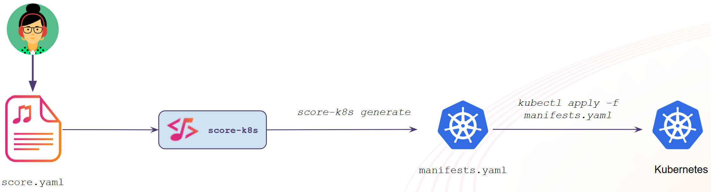

# Getting started with `score-k8s`

From this exact same `score.yaml` file we now want to deploy it to Kubernetes.

Let's do it!

We'll use the `score-k8s` implementation for that.



Initialize your current `score-k8s` workspace, run the following command in your terminal:
```bash
score-k8s init
```

_Note: The `init` command created the `.score-k8s` directory to store a local state, read more about its purpose [there](https://docs.score.dev/docs/score-implementation/local-state/)._

Convert the `score.yaml` file into a deployable `manifests.yaml`, run the following command in your terminal:
```bash
score-k8s generate score.yaml \
    --image scorespec/sample-score-app:latest
```

A new `manifests.yaml` file has been generated, see :fileLink[here]{path="manifests.yaml"}.

All of this technical details abstracted by the `score-k8s` implementation from the Developer.

Before deploying this `manifests.yaml` to Kubernetes, we need a cluster, create a local `kind` cluster by running this command:
```bash
sudo ./scripts/setup-kind-cluster.sh
```

_Note: This command will take a few minutes to properly create and set up the Kind cluster._

Deploy these Kubernetes manifests to spin up our workload and its dependencies in Kubernetes cluster:
```bash
sudo kubectl apply -f manifests.yaml
```

See the running containers and associated resources:
```bash
sudo kubectl get all,statefulset,secret,httproute
```

Test the deployed workload:
```bash
curl $(score-k8s resources get-outputs dns.default#hello-world.dns --format '{{ .host }}:80')
```

At this stage, we used three resource types: `postgres`, `dns` and `route`.

The available resource types and their inputs/outputs could be discovered like this:
```bash
score-k8s provisioners list
```

The actual resources managed by the `score-k8s` implementation can be listed like this:
```bash
score-k8s resources list
```

We'll explore more about these resource provisioners later.

## Resources

- [`score-k8s` implementation](https://docs.score.dev/docs/score-implementation/score-k8s/)
- [Local state directory](https://docs.score.dev/docs/score-implementation/local-state/)