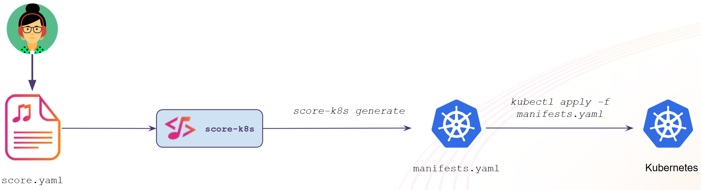

# Getting started with `score-k8s`

From this exact same `score.yaml` file we now want to deploy it to Kubernetes.

Let's do it!

We'll use the `score-k8s` implementation for that.



Initialize your current `score-k8s` workspace, run the following command in your terminal:
```bash
score-k8s init
```

_Note: The `init` command created the `.score-k8s` directory to store a local state, read more about its purpose [there](https://docs.score.dev/docs/score-implementation/local-state/)._

Convert the `score.yaml` file into a deployable `manifests.yaml`, run the following command in your terminal:
```bash
score-k8s generate score.yaml \
    --image scorespec/sample-score-app:latest \
    --output manifests.yaml
```

A new `manifests.yaml` file has been generated, see :fileLink[here]{path="manifests.yaml"}.

## What just happened?

Look at the generated :fileLink[`manifests.yaml`]{path="manifests.yaml"} file. From the same `score.yaml` file, `score-k8s` generated Kubernetes-native resources:

- For the `postgres` resource: a `Secret`, a `StatefulSet` and a `Service`.
- For the `route` resource: an `HTTPRoute` (from the [Gateway API](https://gateway-api.sigs.k8s.io/)).
- For the Workload itself: a `Deployment` and a `Service`.

Compare how the database password is injected in both implementations:
- With `score-compose`, it's a plain value in the :fileLink[`compose.yaml`]{path="compose.yaml" line="10"} file, perfectly fine for local development.
- With `score-k8s`, it's stored in a Kubernetes `Secret` and referenced via `secretKeyRef` in the :fileLink[`Deployment`]{path="manifests.yaml" line="206"}.

Same intent from the Developer, but each implementation follows the best practices of its own platform. All of these technical details are abstracted away from the Developer by the `score-k8s` implementation.

## Deploy and test

Before deploying this `manifests.yaml` to Kubernetes, we need a cluster, create a local `kind` cluster by running this command:
```bash
sudo ./scripts/setup-kind-cluster.sh
```

_Note: This command will take a minute or two to create the Kind cluster, and install the Gateway API and the NGINX Gateway Fabric controller handling the `HTTPRoute` resources._

Deploy these Kubernetes manifests to spin up our workload and its dependencies in Kubernetes cluster:
```bash
sudo kubectl apply -f manifests.yaml
```

Wait for the pods to be ready:
```bash
sudo kubectl wait pods --all --for=condition=Ready --timeout=180s
```

_Note: It's expected to see the `hello-world` pod restarting once, it starts faster than the PostgreSQL database it depends on._

See the running containers and associated resources:
```bash
sudo kubectl get all,statefulset,secret,httproute
```

Test the deployed workload:
```bash
curl --fail --retry 30 --retry-delay 2 --retry-all-errors $(score-k8s resources get-outputs dns.default#hello-world.dns --format '{{ .host }}:80')
```

You should see the same HTML page as with Docker Compose, but this time the PostgreSQL host is `pg-hello-world-...`, running in Kubernetes.

## Discover resources and provisioners

At this stage, we used three resource types: `postgres`, `dns` and `route`.

The available resource types and their inputs/outputs could be discovered like this:
```bash
score-k8s provisioners list
```

The actual resources managed by the `score-k8s` implementation can be listed like this:
```bash
score-k8s resources list
```

We'll explore more about these resource provisioners later.

## Resources

- [`score-k8s` implementation](https://docs.score.dev/docs/score-implementation/score-k8s/)
- [Local state directory](https://docs.score.dev/docs/score-implementation/local-state/)
