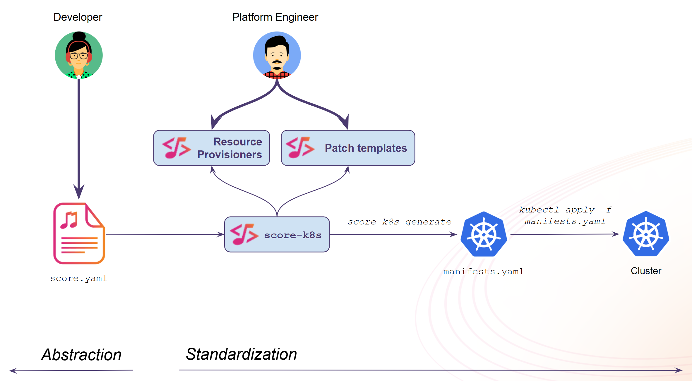

# Conclusion

You’ve completed the **Score Labspace**! 👏

✅ You now know:

- What is Score (Spec versus Implementations)
- How to author a Score file as Developers, using resources and placeholders
- How to use the two default Score implementations: `score-compose` and `score-k8s`, from the exact same `score.yaml` file
- How to override properties of a Score file without modifying it
- How to customize the outputs of the Score implementations with the patch templates feature
- How to define your own resource types with the resource provisioners feature



💡 Key takeaways:

- The Developer's `score.yaml` file never changed during this whole lab.
- Everything platform-specific (images, databases, routes, security settings) was decided on the platform side, by the Score implementations, their patch templates and their resource provisioners.
- The local state directories (`.score-compose` and `.score-k8s`) store the patch templates, the provisioners and the identity of the provisioned resources: keep them around between two `generate` commands.

🎉 Well done!

## Clean up

The containers and the Kind cluster created during this lab run on your Docker engine, and they won't be removed when you close the Labspace. Remove them now:
```bash
docker compose down --volumes
sudo kind delete cluster
```

## Next Steps

- [Explore more examples](https://docs.score.dev/examples/): multiple Workloads talking to each other, more resource types (`redis`, `mongodb`, `s3`, `service-port`, ...), more patch templates and provisioners
- [Other Score implementations](https://docs.score.dev/docs/score-implementation/other/)
- [CI/CD pipelines with Score](https://docs.score.dev/docs/how-to/score-cicd-pipelines/)
- [Join the Score community](https://docs.score.dev/docs/community/)
- Any suggestions to improve this **Score Labspace**? Please help us make it better by filing an issue [there](https://github.com/score-spec/score-labspace/issues)!

Let's Score it! 🎶
